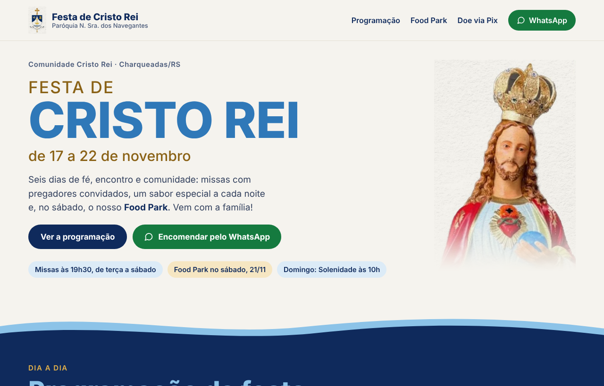

# Festa de Cristo Rei 2026 · Landing page

Landing page da **Festa de Cristo Rei** (17 a 22 de novembro de 2026), da Comunidade Cristo Rei, Paróquia Nossa Senhora dos Navegantes, em Charqueadas/RS.



## ✨ Funcionalidades

- **Programação dia a dia:** tema da missa, pregador, convidados de honra, bênçãos e ação social de cada noite
- **Sabor do dia** com foto, preço e botão de encomenda que abre o WhatsApp com a mensagem já escrita
- **Food Park** de sábado (21/11) com as bancas de cada comunidade e movimento
- **Doação via Pix:** QR Code e botão "Copiar chave"
- Layout responsivo (celular, tablet e desktop), com a identidade visual dos cards da paróquia

## 🛠️ Tecnologias

- HTML5 semântico
- CSS3 (Flexbox, Grid, `clamp()` para tipografia fluida)
- JavaScript puro (sem frameworks)
- Fonte Outfit (Google Fonts) e ícones em SVG inline
- Hospedagem: Cloudflare Pages

## 📁 Estrutura

```
festa-cristo-rei/
├── index.html      # Página completa (HTML, CSS e JS)
├── img/            # Fotos dos pregadores, pratos, imagem de Cristo Rei e QR Code Pix
└── docs/           # Imagens de prévia do README
```

## ⚙️ Como configurar

WhatsApp, chave Pix e mensagens ficam no objeto `CONFIG`, no `<script>` do fim do `index.html`:

```js
const CONFIG = {
  whatsapp: "5551998847341",
  whatsappTexto: "(51) 99884-7341",
  pix: "...",
  mensagens: { geral: "...", d17: "...", d18: "...", d19: "...", d20: "...", d22: "..." }
};
```

Para trocar o QR Code do Pix, substitua `img/pix-qrcode.png` mantendo o mesmo nome.

## ▶️ Como rodar localmente

Não há dependências nem etapa de build: basta abrir o `index.html` no navegador ou usar a extensão **Live Server** no VS Code.

## 👩‍💻 Autora

Desenvolvido por **Katia Dutra**, estudante de Tecnologia em Sistemas para Internet.
